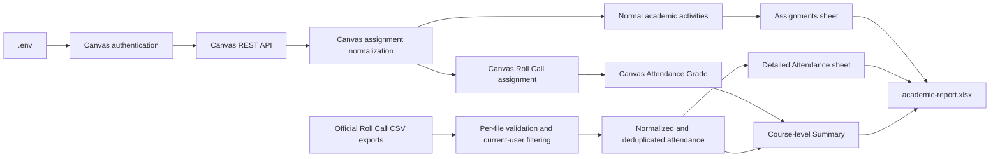

# Academic pipeline

The academic pipeline writes an Excel workbook from live Canvas assignments and detailed attendance sessions in official Roll Call exports. The CLI reads local files; the Telegram bot accepts one uploaded CSV per report.

The tested standard Canvas APIs expose Roll Call as an external-tool assignment with an aggregate grade, but not its individual class-date attendance sessions. Those detailed records therefore come from offline official Roll Call CSV exports. Each file is filtered to the current Canvas profile ID before normalization.

Normal academic activities and attendance remain separate because they represent different record types and granularities. Roll Call is identified from its Instructure external-tool/LTI metadata, not its editable assignment display name. It is excluded from the Assignments sheet and from all academic activity counts, while its exact Canvas grade appears only as Canvas Attendance Grade in Summary. Detailed attendance still comes from official offline Roll Call CSV exports.

Summary counts normal Canvas assignments by official status: Submitted, Pending, and Excused. Graded counts assignments with a nonempty Canvas grade independently of submission status. Upcoming 7 Days counts pending assignments due from report generation time through exactly 168 hours later; Overdue Pending counts pending assignments due before report generation time. Due dates display in Asia/Manila. Assignments without a due date remain pending but count in neither due-date metric. No overall course grade or GPA is inferred.

The Assignments sheet sorts by course and due date, with missing due dates last. It displays official Canvas status (including Overdue for past-due pending work), Canvas Grade, Score, Points Possible, and Percentage. Percentage is Score divided by Points Possible only when Canvas supplies a nonempty grade and positive Points Possible; a raw zero score without a grade does not imply a graded zero. Valid Canvas URLs appear as direct links. Due dates are sortable Excel dates displayed in Manila time.

Detailed Present, Absent, and Late records come only from offline Roll Call CSV exports. Summary's Attended % is `(Present + Late) / Attendance Records`, using recorded, deduplicated events only. The denominator is shown beside the percentage. Courses without detailed offline attendance retain blank attendance cells and percentage, even when Canvas provides an aggregate Roll Call grade. Canvas Attendance Grade is the exact separate value from Canvas, not a calculation from CSV records.

Place one or more official CSV exports directly in `data/input/attendance/`. Exports may cover different courses and date ranges, and filenames do not determine course identity or priority. Identical overlapping events are deduplicated by Course ID, Section ID, and Class Date. If records for the same event have conflicting statuses, report generation stops with a safe conflict error; no status is silently chosen. Missing rows are never interpreted as presence or absence.

For Telegram, send one official Roll Call CSV as a document to the authorized private chat. The bot processes that upload alone in memory, applies the same current-user filtering and deduplication, and sends an `.xlsx` report. Use `/report` for instructions. The default 5 MiB CSV limit can be changed with `TELEGRAM_REPORT_MAX_CSV_MIB` (1–20 MiB). Telegram file download and document upload are subject to the hosted Bot API's [20 MB download and 50 MB upload limits](https://core.telegram.org/bots/api). The uploaded filename is ignored.

Summary includes courses discovered through returned Canvas assignments. Courses with no returned assignments are not added solely for completeness in this MVP.

The raw exports contain private educational data and are ignored by Git, as is the generated report. Missing student/date rows are never interpreted as present or absent, and the pipeline does not fabricate attendance records or percentages. A future personal activity-status integration can pass a separate Guardian status by `courseId:assignmentId`; it must leave this report's official Canvas submission and grade fields unchanged.

## Local usage

1. Place official exports at `data/input/attendance/*.csv`.
2. Configure `.env` with `CANVAS_BASE_URL` and `CANVAS_ACCESS_TOKEN`.
3. Run `npm run academic:pipeline`.
4. Open `data/output/academic-report.xlsx`.
